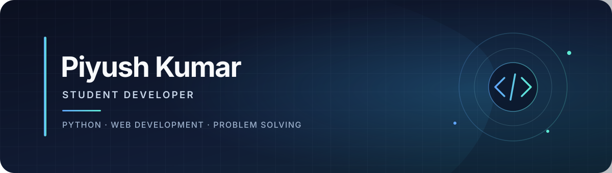

  

  <a href="https://codewithpiyush.vercel.app"><strong>Portfolio</strong></a>

### About

I’m a first-year student at Newton School of Technology, Rishihood University, building a strong foundation in software development. I’m learning Python and core programming concepts while creating hands-on web projects. I enjoy breaking down problems and turning ideas into clear, useful solutions.

### Current Focus

- Strengthening my Python and programming fundamentals
- Building and improving practical web projects
